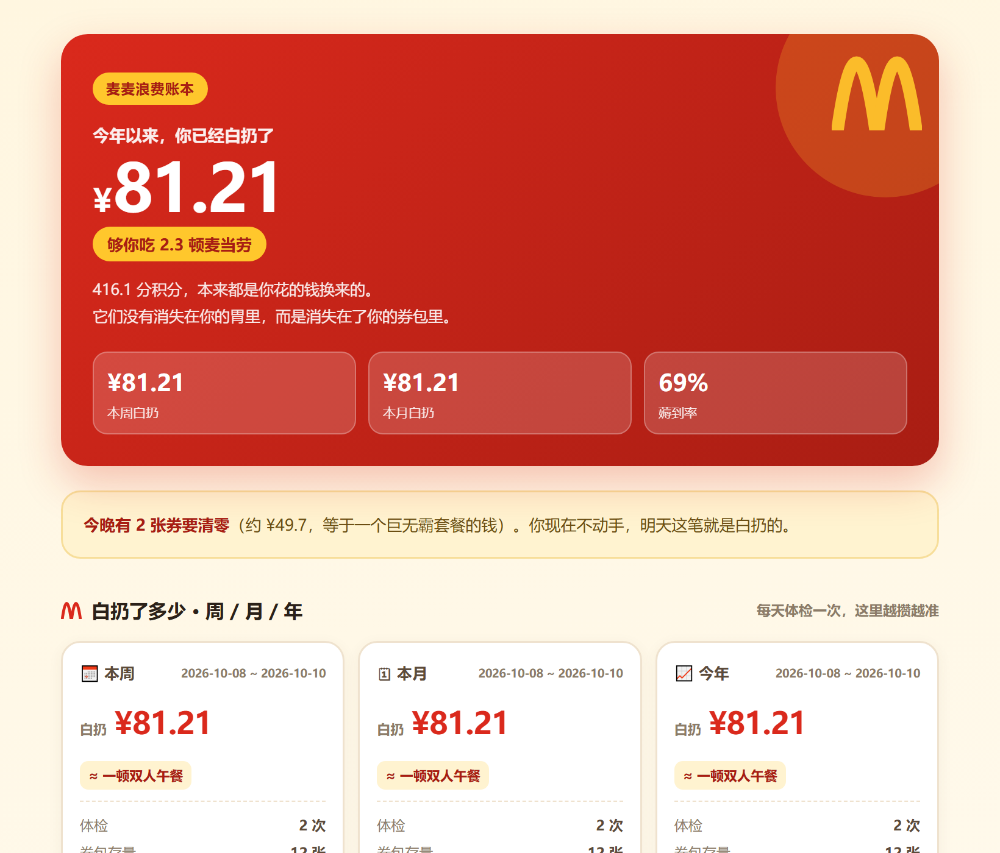
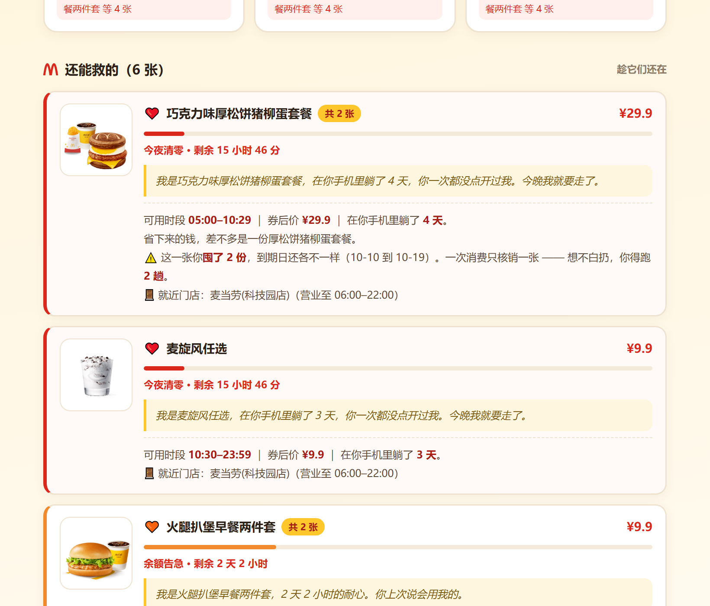
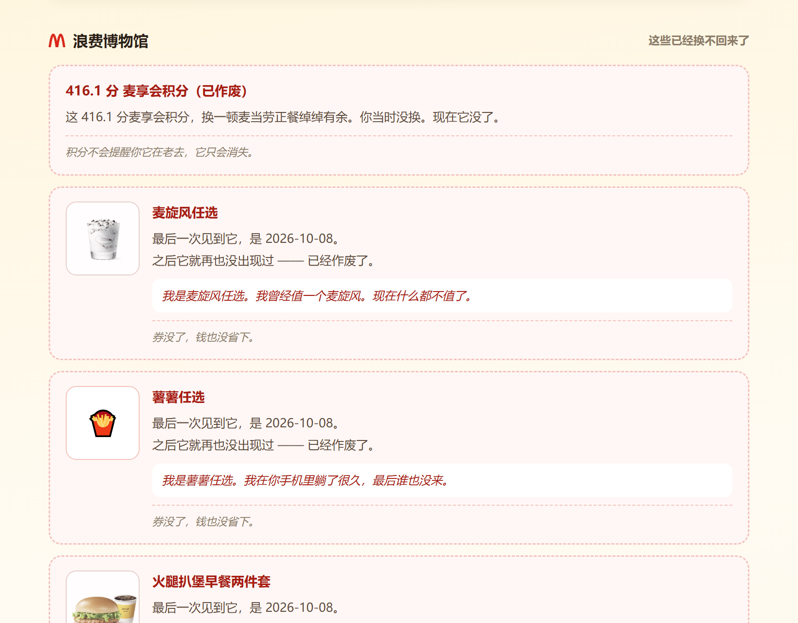

# 🍟 抢救麦券大作战 · MCD-COUPON-RESCUE

> **它不告诉你有什么券，它告诉你你一直在白扔多少钱。**
>
> 麦当劳程序员创意开发大赛（M-CODE 2026）参赛作品 · 基于麦当劳官方 MCP · WorkBuddy Skill
> 非麦当劳官方产品

---

## 这是什么

市面上所有省钱工具都在做同一件事：把券列出来，告诉你"你有 N 张券"。这是把 MCP 返回的数据原样复述一遍 —— **信息搬运，不是创意**。

**这个作品做的是另一件事：算你浪费了多少钱。**

优惠券和积分都是有期限的。到期那一刻，它们就变成实打实的白扔 —— 你为它们花的钱，一点没省回来。而绝大多数人根本不知道自己正在白扔，直到某天打开 App，发现包里空空如也。

| 常规工具的说法 | 本作品的说法 |
|---|---|
| 有效期 | **还剩多久 / 不用它你会白扔多少** |
| 可用券列表 | **还能救的清单**（带倒计时 + 门店打烊时间 + 产品图） |
| 已过期 | **浪费博物馆**（已经换不回来的东西） |
| 节省金额 | **薅到率 + 周/月/年累积白扔总额** |

**用词红线：全程不说"死 / 临终 / 病危 / 墓志铭"这类晦气词。** 吃麦当劳是快乐的事，提醒你省钱也该是快乐的、有点自嘲的，不能带阴间气、不能引起反感。

---

## 效果预览

### 顶部账单 + 周/月/年浪费统计

红底金拱门 + 一屏就能看懂的大数字 + 实物换算：



> **你已经白扔了 ¥61.41** —— 这笔钱够你吃 1.8 顿麦当劳。
> 416.1 分积分，本来都是你花的钱换来的。
> **它们没有消失在你的胃里，而是消失在了你的券包里。**

### 券卡：产品图 + 券的第一人称自述

每张券配的是麦当劳官方产品图（直接消费 MCP 返回的 `image` 字段），
下面是这张券自己说的话：



> ❤️ **火腿扒堡早餐两件套** ¥9.9
> 余额告急 · 剩余 2 天 2 小时
> 「我是火腿扒堡早餐两件套。我还能撑 2 天 2 小时。你要不要考虑一下我？」
> ⚠️ 这一张你囤了 3 份，到期日还各不一样。一次消费只核销一张 —— 想不白扔，你得跑 3 趟。

### 浪费博物馆：已经换不回来的东西

**图会褪色** —— 一眼就能看出"它过去了"：



> 🗑 **麦旋风任选**
> 最后一次见到它，是 2026-10-08。之后它就再也没出现过 —— 已经作废了。
> 「我是麦旋风任选。我曾经值一个麦旋风。现在什么都不值了。」

完整成品（自包含 HTML，双击即可打开，无需联网、无需 Token）：

- [`examples/麦麦浪费账本.html`](examples/麦麦浪费账本.html) — 真实账号数据
- [`examples/麦麦浪费账本_演示版.html`](examples/麦麦浪费账本_演示版.html) — 离线演示版

完整效果见 `examples/` 下的截图与 HTML。

---

## 四个设计手法

1. **换算成实物** —— ¥41.6 没感觉，"一顿麦当劳正餐"有感觉
2. **精确到分钟** —— "还剩 2 小时"不如"1 小时 45 分后它就从你的世界消失了"
3. **关注点在失去，不在拥有** —— 主语从"你有"换成"你已经让……躺到作废了"
4. **让券自己开口** —— 用户对"一张券"没感情，但对"一个在你手机里躺了 4 天、你一次都没点开过的家伙"会有一丝内疚

语气上是"损友"而不是"家长"：像好朋友损你一句，笑完还愿意听。绝不说教。

---

## 核心机制

### 1. 券生命周期引擎

根据真实 `tradeEndDateTime` 计算剩余时间，划分六个阶段：

| 阶段 | 判定 | 标记 | 处置 |
|---|---|---|---|
| 充裕 | > 7 天 | 💚 | 不打扰 |
| 悠着点 | 3–7 天 | 💛 | 轻提示 |
| 余额告急 | 24h–3 天 | 🧡 | 给出行动方案 |
| 今夜清零 | < 24 小时 | ❤️ | 最高优先级 |
| 已化灰 | 已过期 | 🗑 | 进浪费博物馆 |
| 待查明 | 券面无到期信息 | ⚪ | 提示主动确认，别赌 |

### 2. 三条数据线交叉运算

行动方案不是模板话术，是三份真实数据的交叉计算：

```
券的到期时间（query-my-coupons.tradeEndDateTime）
  × 门店营业时间（query-nearby-stores.businessEndTime）
  × 券可用时段（tradeTimePeriods，如早餐券限 05:00–10:29）
```

产出：

> 🚪 最近的麦当劳深圳北站站内一店已经打烊了（营业至 06:00–22:00）。
> 今晚大概率是保不住了 —— **这就是白扔的现场**。

这句话无法从任何一个接口单独得到，必须是算出来的。

### 3. 本地累积记账 + 化灰检测（最核心）

**麦当劳券包接口只返回"当前还在"的券，过期的会被静默移除。** 所以你永远查不到"我一共白扔了几张"。

本作品每天记一笔账，靠 **"上一次记录的券，这一次不见了"** 来推断真实的白扔：

```
2026-10-08 记录：麦旋风任选、薯薯任选、火腿扒堡、大脆鸡扒堡
2026-10-10 记录：火腿扒堡、大脆鸡扒堡（少了 2 张）
                    ↓
              这 2 张化灰了，白扔 ¥19.8
```

这是任何单次查询都拿不到的数据。累积出周/月/年的浪费账单，让用户看见"我一直在亏"。

---

## 快速开始

### 1. 申请 MCP Token

在 [open.mcd.cn/mcp](https://open.mcd.cn/mcp) 用手机号申请。

写入 `~/.workbuddy/mcp.json`：

```json
{
  "mcpServers": {
    "mcd-mcp": {
      "type": "streamableHttp",
      "url": "https://mcp.mcd.cn",
      "headers": { "Authorization": "Bearer 你的 Token" }
    }
  }
}
```

> ⚠️ **不要把真实 Token 提交进任何仓库。** 本仓库已用 `.gitignore` 排除本地配置。

### 2. 安装 Skill

把本仓库整个目录放到：

```
~/.workbuddy/skills/mcd-life/
```

### 3. 跑起来

```bash
cd scripts

# 券包体检
python coupon_life.py exam

# 只看浪费博物馆
python coupon_life.py waste

# 记一笔账 / 看周月年账单
python ledger.py snapshot
python ledger.py stats

# 生成《麦麦浪费账本》HTML（自动记一笔账 + 内联产品图）
python settle_card.py --out 麦麦浪费账本.html

# 演示版：离线数据 + 示例账本（一眼看到周期统计和化灰效果）
python settle_card.py --demo --no-record --sample-ledger --out 演示版.html
```

### 4. 在 Agent 里用

对本 WorkBuddy 说：

> "帮我看看我的券要过期了吗" / "券包体检" / "我浪费了多少券"

---

## 项目结构

```
mcd-coupon-rescue/
├── SKILL.md                       # 技能主文件（SOP / 红线 / 语气标准）
├── SUBMIT.md                      # 参赛提交说明
├── scripts/
│   ├── mcd_client.py              # MCP 客户端 + 自动降级
│   ├── roast.py                   # 话术引擎（食物换算 / 损友吐槽 / 券拟人化）
│   ├── imgcache.py                # 产品图管线（下载 / 缓存 / base64 内联）
│   ├── coupon_life.py             # 券生命周期引擎（核心）
│   ├── ledger.py                  # 本地累积记账 + 周/月/年统计
│   └── settle_card.py             # 浪费账本生成器
├── references/
│   ├── mcp-tools.md               # 麦当劳 MCP 33 个工具速查 + 真实字段表
│   └── offline_menu.json          # DEMO 离线数据集
├── assets/
│   ├── settlement_card_template.html  # 浪费账本模板
│   ├── ledger_sample.json             # 示例账本
│   └── img/coupons/                   # 归档的真实券图（离线演示用）
└── examples/                      # 成品 HTML 与预览截图
```

---

## 技术亮点

- **全量接入麦当劳 MCP**：券、积分、门店、菜单、算价、活动、积分商城
- **独立话术引擎** `roast.py`：金额→食物换算、分钟级倒计时、损友吐槽库、券第一人称拟人台词（轮换分配避免撞车）—— 把"趣味性"做成可复用模块，而不是散落的字符串
- **产品图管线** `imgcache.py`：直接消费 MCP 返回的官方券图，并发下载 + 本地缓存 + base64 内联，单文件自包含；COS 图自动走数据万象缩略图（79KB → 44KB）；**零第三方依赖**
- **本地累积记账 + 化灰检测**：靠"券在两次快照间消失"推断真实白扔
- **三线交叉的可行性判断**：券到期 × 门店营业 × 券可用时段
- **薅到率的券 + 积分综合口径**：避免出现"券全用上了但积分白扔 416 分，还显示 100%"的自相矛盾
- **自动降级架构**：Token 失效时切换到本地数据集（含离线券图），演示永不中断

---

## 隐私与安全

- 本仓库**不含任何 Token、账号或个人信息**
- 所有数据来自麦当劳官方 MCP 的你自己的账号，本地处理，不外传
- `.gitignore` 已排除 `data/`（本地账本）与 `assets/img/*`（运行时缓存）
- 输出仅供参考，不构成医疗或营养建议；价格与库存以 MCP 实时结果为准

---

## 免责声明

本项目为**个人参赛作品**，非麦当劳官方产品，与麦当劳中国无隶属关系。
"麦当劳""金拱门"等商标归其权利人所有，本项目仅作技术演示用途。
下单等写入操作均需用户二次确认后才执行。

---

## License

[MIT](LICENSE)
